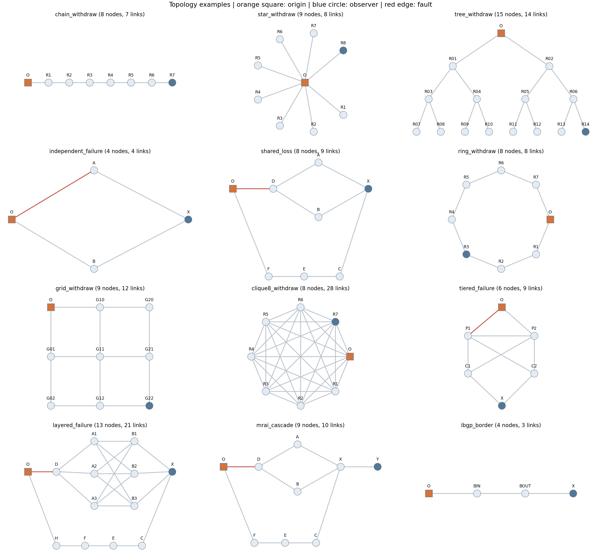
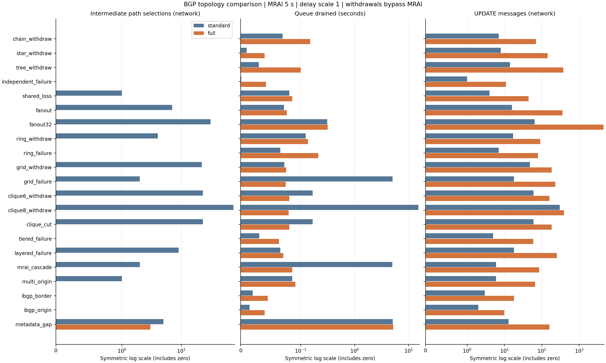
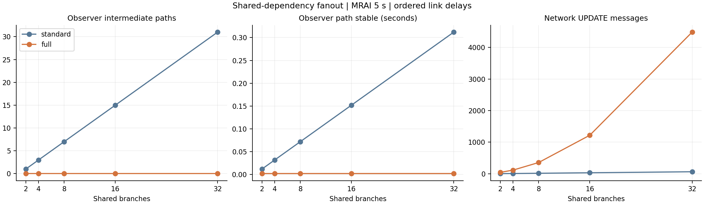

# BGP 版本化路径依赖图的 5 秒 MRAI 拓扑实验

2026-10-11，在 BgpTester 的现有 Qt 源码插件上完成 **28 个拓扑、34 个场景、544 组运行、1056 个测量阶段**。所有链路双向 MRAI 固定为 **5000 ms**。标准 BGP 和完整方案使用相同拓扑、选路策略、故障序列及链路延迟。

结果支持的结论是：**共享失效依赖越多，版本化退役传播越能减少无效路径探索；只有这些探索实际触发后续 MRAI 等待时，才可能带来显著的全网收敛加速。** 当前完整实现也会增加 UPDATE 数量；退役事实早于替代路径到达时，还可能增加暂态无路由时间。

在全部 136 对首次扰动对照中，全网中间路径选择有 **94 对减少、42 对相同、0 对增加**；队列清空时间有 **26 对缩短、110 对增加**；UPDATE 总数全部增加。这些是构造场景和固定延迟排列的结果，不是互联网平均收益或独立统计样本。

## 输入和复现产物

| 产物 | 内容 |
|---|---|
| [场景矩阵](../../topology_sweep_mrai5.json) | 每个故障、恢复、观察点、延迟种子及机制配置 |
| [拓扑目录](../../../topo/versioned_mrai5/) | 28 个可载入 BgpTester 的 JSON，双向 MRAI 均为 5000 ms |
| [完整数据表](TABLES.md) | 全部 34 个场景的主表、消融表和输入索引 |
| [逐阶段 CSV](phases.csv) | 1056 个阶段，含观察点路径序列及全部标量指标 |
| [成对比较 CSV](comparisons.csv) | 264 对标准 BGP 与 full 的对应阶段，含初始路径一致性 |
| [原始结果](raw_results.json.gz) | 压缩 JSON，保留每台路由器的初始、最终路径、变化序列及依赖图 |
| [摘要](summary.json) | 运行数量、指标分布和原始数据 SHA-256 |
| [输入溯源](provenance.json) | 可执行文件、源码、拓扑与场景哈希，运行命令和环境 |
| [验证记录](validation.json) | 完整重跑、逐消息轨迹核对、压缩归档重建和回归测试结果 |
| [拓扑图册](topology_atlas.pdf) | 28 个拓扑的分页图示 |

本轮新增了 20 个拓扑和 22 个场景，并将原有 8 个拓扑、12 个场景复制到独立实验目录后统一为 5 秒 MRAI。旧的 1/5/30 秒实验输入和结果保持独立。

## 实验控制与指标

每个场景运行 `standard`、`path_only`、`local`、`full` 四种机制，分别采用链路延迟倍率 1 和 3，并对 `withdrawal_ignores_mrai=true/false` 各运行一次。因此共有 `34 × 4 × 2 × 2 = 544` 组。两个快速恢复场景只有一个阶段，其余场景各有扰动、恢复两个阶段。

`standard` 使用现有标准 BGP 插件。`path_only` 保留正向版本和精确撤销绑定，不交换退役事实；`local` 发布本节点退役事实，远端事实仅在本地使用；`full` 再把远端事实去重转发给所有已建立会话。**独立退役消息仍按当前实现绕过 MRAI。** 所以本实验评估的是完整实现与标准 BGP 的差异，不能把全部收益归因于图结构本身。

每个独立阶段先等待 `5000 + 2 × 最大链路延迟 + 1 ms`，使上一阶段 MRAI 定时器到期。快速恢复在同一阶段第 0 ms 断链、第 3 ms 重连。每次运行先完成启动收敛，启动消息不计入扰动阶段。136 对首次扰动的初始全网普通路径均一致；恢复阶段延续各机制自身的故障后状态，CSV 单独记录其初始状态差异。

路径统计针对 `192.0.2.0/24`；另有 `198.51.100.0/24` 用于前缀隔离检查。消息量覆盖全网所有前缀，包括因同一链路故障受影响的第二前缀。`clique_cut` 切断唯一出口时，第二前缀也应失去可达性，该阶段显式使用对应预期。

| 指标 | 定义与解释 |
|---|---|
| 中间路径选择 | 记录 `(有无路由, learnedFrom, AS_PATH)` 的每次变化；其中非空且不同于阶段最终路径的选择计一次。排除纯版本刷新，包含下一跳不变但 AS_PATH 改变的情况。 |
| 失效 AS 路径选择 | 选择时，声明路径包含已断开的 AS 邻接，或末端 AS 已无该前缀起源。仅适用于每 AS 一台路由器的拓扑，iBGP 场景不适用。它不是完整的新鲜度判定，也不等于实际转发失败。 |
| 观察点路径稳定时间 | 最后一次普通路径变化距阶段开始的虚拟时间；包括撤销到无路由。 |
| 全网队列清空时间 | 所有路由消息、独立状态消息及有效定时任务处理完毕的虚拟时间；静默窗口设为 0。 |
| UPDATE 总数 | `announcements_sent + withdrawals_sent + control_updates_sent`，每条发送计一次；撤销和状态记录同样由 UPDATE 承载。 |
| 有物理通路但代理不可用 | 尚有物理路径通向有效起源，但沿当前 `learnedFrom` 链无法到达起源的累计时长。仅为控制面转发代理，不模拟包、IGP 或 FIB。 |

“中间路径”可能是有效的暂态路径；不能一概称为错误路径。永久撤销唯一源后的无路由是预期状态，各机制队列清空时刻又不同，因此 CSV 中这一类阶段的 `proxy_no_route_ms` 不能直接比较为业务中断时间。扩展字节数是语义负载估算，历史节点数也不是峰值内存。

## 拓扑覆盖



链、星、二叉树用于检查无替代路径的边界；独立菱形检查有效备用；环、网格和全互联检查重叠替代路径；2/4/8/16/32 分支扇出和两层 3×3 汇合检查共享依赖规模；商业分层拓扑执行 provider/customer 偏好和 valley-free；其余场景覆盖多起源、普通 iBGP 多边界、空 AS_PATH 起源、仅出口过滤以及快速恢复。

链、星、树、环、网格和全互联使用 `unspecified` 商业关系，允许普通 eBGP 传播，以观察结构产生的探索。商业分层、共享依赖和扇出使用明确关系。两组机制在同一场景内策略相同，但不同拓扑之间的差异同时受结构、延迟和策略影响。

## 各类结构的代表性结果

以下均为首个扰动阶段、延迟倍率 1、撤销绕过 MRAI。箭头表示 **标准 BGP → full**；路径计数为全网针对目标前缀的中间路径选择。

| 拓扑与扰动 | 中间路径选择 | 全网队列清空 s | UPDATE 总数 | 解释 |
|---|---:|---:|---:|---|
| 8 节点链，起源撤销 | 0 → 0 | 0.070 → 0.150 | 7 → 70 | 唯一路径，没有可抑制的探索 |
| 9 节点星，起源撤销 | 0 → 0 | 0.010 → 0.040 | 8 → 144 | 叶节点没有备用，状态传播仅增加成本 |
| 15 节点树，起源撤销 | 0 → 0 | 0.030 → 0.100 | 14 → 380 | 分叉但不合流，缺少共享候选 |
| 独立菱形，首选链路故障 | 0 → 0 | 0.001 → 0.042 | 1 → 11 | 标准 BGP 已能直接转到有效备用 |
| 2 分支共享依赖失效 | 1 → 0 | 0.081 → 0.086 | 4 → 44 | 跳过过时备用，控制消息尾部略长 |
| 8 分支共享依赖失效 | 7 → 0 | 0.072 → 0.077 | 16 → 356 | 一项共同依赖事实排除 7 次探索 |
| 32 分支共享依赖失效 | 31 → 0 | 0.312 → 0.317 | 64 → 4484 | 观察点提前稳定，但广播成本很高 |
| 8 节点环，起源撤销 | 4 → 0 | 0.124 → 0.136 | 17 → 91 | 过滤另一方向上的旧路径 |
| 8 节点环，单边故障 | 0 → 0 | 0.066 → 0.211 | 7 → 79 | 此构造无需探索旧候选即可绕行 |
| 3×3 网格，起源撤销 | 22 → 0 | 0.073 → 0.076 | 48 → 184 | 大量局部探索被消除，但未节省整轮 MRAI |
| 3×3 网格，起源邻边故障 | 2 → 0 | 5.041 → 0.075 | 18 → 228 | 少量探索已足以触发一轮 MRAI 等待 |
| 6 节点全互联，起源撤销 | 23 → 0 | 0.167 → 0.081 | 60 → 160 | 远端退役事实提前清除旧路径 |
| 8 节点全互联，起源撤销 | 75 → 0 | 15.138 → 0.080 | 303 → 392 | 消除多轮路径增长和 MRAI 等待 |
| 6 节点全互联，唯一出口断开 | 23 → 0 | 0.167 → 0.081 | 60 → 185 | 起源仍存在，所有路由共享的出口失效 |
| 双上游商业分层，单链路故障 | 0 → 0 | 0.031 → 0.064 | 5 → 59 | 此策略与故障组合已有有效备用 |
| 两层 3×3 汇合，共享出口故障 | 9 → 0 | 0.066 → 0.071 | 18 → 253 | 同一依赖在两层候选中重复出现 |
| 下游 MRAI 级联 | 2 → 0 | 5.003 → 0.086 | 6 → 85 | 跳过中间通告，避免下游等待 5 秒 |
| 双起源，撤销一个源 | 1 → 0 | 0.086 → 0.091 | 6 → 66 | 保留独立起源，过滤旧起源的共享候选 |
| 普通 iBGP 多边界，源撤销 | 0 → 0 | 0.020 → 0.045 | 3 → 18 | 验证身份与撤销绑定，未构造出探索收益 |
| 退役先到的快速恢复 | 5 → 3 | 5.081 → 5.163 | 13 → 160 | 减少旧路径选择，同时增加无路由窗口 |



全互联规模从 6 增至 8 时，这组固定延迟下标准 BGP 从亚秒级变为多轮 MRAI 收敛。此差异依赖具体到达顺序，不能据两个规模点推导普遍的规模阈值或复杂度定理。

## 共享依赖的规模和到达顺序

有序扇出中，观察点 X 最初选中最快分支，每个后续分支都引用同一个 D 的旧状态。D—O 断开后，标准 BGP 逐个尝试这些分支；full 得知 D 的退役事实后直接选择独立备用 C。

| 分支数 | X 的中间路径次数 | X 路径稳定 s | 全网 UPDATE 数 |
|---:|---:|---:|---:|
| 2 | 1 → 0 | 0.012 → 0.002 | 4 → 44 |
| 4 | 3 → 0 | 0.032 → 0.002 | 8 → 116 |
| 8 | 7 → 0 | 0.072 → 0.002 | 16 → 356 |
| 16 | 15 → 0 | 0.152 → 0.002 | 32 → 1220 |
| 32 | 31 → 0 | 0.312 → 0.002 | 64 → 4484 |



观察点收益随被跳过的分支增加，但 full 的消息增长明显快于标准 BGP。32 分支中 4484 条 UPDATE 有 4356 条为独立状态消息。该构造下，大量新退役事实向全部会话传播，使传播成本随分支数迅速增加。

8 分支还采用反向、等延迟和三种固定种子的洗牌排列。标准 BGP 的中间路径次数依次为：有序 7、反向 1、等延迟 7、种子 7 为 2、种子 19 为 2、种子 42 为 4；full 均为 0。倍率 3 和撤销受 MRAI 限制时，这些计数仍成立。

**等延迟是一个边界例子：** 标准 BGP 的 7 次中间选择都发生在第 11 ms；两种机制的 X 均在第 11 ms 选定最终路径。full 减少选择次数，却没有提前该观察点的稳定时间。固定事件排序下的同一时刻多次选择不等于多个毫秒的业务中断。

## 5 秒 MRAI 怎样放大一次中间通告

`mrai_cascade` 的关键结构为 `D → {A, B} → X → Y`，X 另有经 C 的独立备用。D—A 为 1 ms，D—B 为 80 ms，X—Y 为 1 ms，故障为 D—O 断开。

| 故障后时刻 | 标准 BGP | full |
|---:|---|---|
| 2 ms | X 从 A 改选仍引用旧 D 的 B | X 直接选择 C |
| 3 ms | Y 收到经 X—B 的中间路径 | Y 收到经 X—C 的最终路径 |
| 81 ms | X 改选 C，但 X→Y 的 MRAI 尚未到期 | Y 已有最终路径 |
| 5003 ms | Y 收到最终 AS_PATH，全网结束 | 全网已于 86 ms 结束 |

Y 的下一跳一直为 X，仅统计下一跳切换会漏掉这个探索。因此本轮补充了完整 AS_PATH 变化统计，旧的 `observer_changes` 仍保留用于兼容。

这里全网控制面时间为 5.003 → 0.086 秒，降幅约 98.3%；沿 `learnedFrom` 的代理不可用时间为 0.081 → 0.002 秒。不能把 4.917 秒控制面差异表述为同等时长的丢包改善。

## 撤销调度与消融对照

| 场景 | 撤销是否绕过 MRAI | 全网中间路径 | 全网队列清空 s |
|---|---|---:|---:|
| 8 节点全互联起源撤销 | 是 | 75 → 0 | 15.138 → 0.080 |
| 8 节点全互联起源撤销 | 否 | 87 → 0 | 30.036 → 0.080 |
| 网格单链路故障 | 是 | 2 → 0 | 5.041 → 0.075 |
| 网格单链路故障 | 否 | 3 → 0 | 5.041 → 5.030 |
| 下游 MRAI 级联 | 是 / 否 | 2 → 0 | 5.003 → 0.086 |

网格场景说明，旧路径探索消失后仍可能存在 MRAI 等待。完整方案中的独立状态消息不受该开关限制，路由通告与绑定撤销则使用对应传输规则；比较时必须保留这一实现事实。

消融进一步区分了收益来源。32 分支场景中，`standard/path_only/local/full` 的全网中间路径次数是 **31/31/31/0**，必须把远端 D 的事实继续转发给 X 才能批量排除共享候选。8 节点全互联中则为 **75/24/0/0**；各节点直接邻接起源，`local` 已可获得充分证据，UPDATE 为 **105 条**，少于 full 的 **392 条**。因此全会话传播不是每种拓扑都必要的成本。

## 可用性反例和恢复阶段

`metadata_gap` 中，D—O 第 0 ms 断开、第 3 ms 恢复，另有 D—Z—O 通路。X 始终与仍在发布前缀的起源物理连通。full 于第 15 ms 获得新的退役事实后清除旧候选，替代正向通告直到第 5002 ms 才到达。

撤销旁路开启时，标准 BGP 的观察点无路由时间为 **0**，full 为 **4.987 秒**；计入另外 1 ms 的下游代理不可用后，full 的“有物理通路但代理不可用”为 **4.988 秒**。关闭撤销旁路时，无路由窗口为 **5.066 秒**，全网队列清空时间为 **10.002 秒**。少选过时路由并不自动意味着更高可用性。

恢复阶段也保留在结果中。网格单边故障的恢复，在旁路开启的两种延迟倍率下，full 各多选择一次**有效**中间路径：标准为 0，full 为 1，失效 AS 路径选择均为 0；观察点最终稳定时间相同。这两对恢复开始时的全网路径不同，因此应解释为此前协议历史和恢复行为的整体差异。合并恢复阶段后的 264 对结果为：中间路径 **94 对减少、168 对相同、2 对增加**。

## 验证与复现

运行期间检查了收敛事件预算、观察点与第二前缀的最终可达性、全部已选最终路径的转发代理、合法版本属性以及活动依赖图的引用、后继、无环性和分量计数。544 组均通过。汇总脚本还检查矩阵完整性、阶段对应、消息分类守恒、路径序列时间顺序和最终 RIB 一致性。

完整矩阵重跑后，544 组测量值一致；另行记录的 12 组逐消息轨迹与主矩阵完全一致，从这些轨迹独立重建的 22 个阶段全网路径序列也与原始结果相符。压缩归档可重新生成完全一致的 CSV、数据表和摘要。现有 7 项 CTest 回归全部通过，其中包括原有 576 组多 MRAI 矩阵；新矩阵的 `--quick` 入口也验证仍使用 5000 ms。

源码只增加实验输入、统计与输出，没有修改标准 BGP 或版本化插件的选路逻辑。构建使用 `BGPTESTER_BUILD_ROUTER_EXPERIMENTS=ON` 的 Qt Core/Sql 实验目标；普通 portable CLI 不是本插件的执行入口。构建前提与完整命令见 [BgpTester README](../../../README.md#版本化路径依赖图实验)。

从工作区根目录复现本次实验：

```bash
python3 BgpTest/BgpTester/experiments/run_topology_sweep.py \
  --binary /tmp/bgptest-plugin-build/bin/BgpTesterExperiments
```

其他环境把 `--binary` 换成自己构建的 `BgpTesterExperiments` 路径。该命令重建 5 秒拓扑、运行完整矩阵、校验并输出 CSV、数据表、压缩原始结果及溯源文件。加 `--plots` 可生成 PNG/PDF，需安装 Matplotlib；只生成数据和表格不需要额外 Python 依赖。本次图表使用 Matplotlib 3.10.9，图中标签采用场景标识以便与 CSV 对照。

也可以仅从压缩归档重新汇总和绘图：

```bash
python3 BgpTest/BgpTester/experiments/summarize_topology_sweep.py \
  BgpTest/BgpTester/experiments/results/topology_mrai5/raw_results.json.gz --plots
```

本轮证据适合支持“共享依赖旧候选的批量排除”以及“某些结构中避免 MRAI 放大的路径探索”两项结论。消息传播范围、事实合并及退役信息与替代正向通告的协调，是当前结果暴露出的主要后续优化方向。
